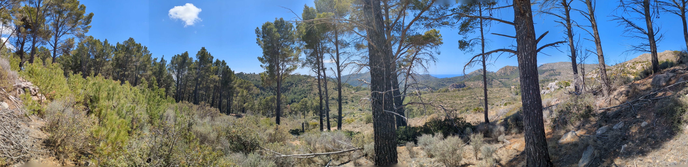

# Després d'un incendi forestal: què hem de fer?

Tard o d’hora, a la Mediterrània, el foc arriba. I quan l’incendi s’ha apagat, les persones que són propietàries d’una finca forestal es troben davant una pregunta inevitable: **i ara, què hem de fer?**

Un incendi pot causar danys importants, però no tot el que crema queda igual de malmès. Quan el foc crema amb poca intensitat, els efectes sobre el bosc solen ser més limitats i, en determinades condicions, fins i tot pot contribuir a mantenir-ne la salut i la diversitat a llarg termini, com explicàvem a [El paper ecològic del foc]({{ '/ecology/' | relative_url }}).

Per això, abans de començar a tallar arbres, retirar fusta o plantar, és important entendre què ha passat a cada part de la finca. **No totes les zones necessiten les mateixes actuacions: algunes requereixen intervenció, mentre que en d'altres la millor opció és deixar que la regeneració natural segueixi el seu curs.**

Aquesta guia s'inspira en una publicació de la Universitat de Califòrnia adreçada a propietaris forestals (Shive i Kocher, 2017), adaptada a les característiques dels boscos, el clima i els paisatges de les Illes Balears.

---

## Primer, la seguretat

Abans de pensar en la recuperació del bosc, cal garantir la seguretat de les persones:

- No entris a la zona cremada fins que les autoritats n'hagin autoritzat l'accés. Hi pot haver soques, arrels i altres restes que encara cremin sota terra.
- Vigila els **arbres morts o debilitats** a prop de cases, camins i carreteres. Poden caure sense avís, especialment amb vent o després de pluges intenses.
- Revisa els camins, les cunetes i els passos d'aigua abans de les primeres pluges fortes. El foc pot haver debilitat les infraestructures i augmentat el risc d'obstruccions i esllavissades.

---

## Un calendari d’actuacions

No cal fer-ho tot alhora. Algunes decisions són urgents i d’altres convé prendre-les amb calma, quan es vegi com respon el bosc:

| Quan? | Què convé fer? |
| --- | --- |
| **Immediatament** | Garantir la seguretat i identificar riscos |
| **Abans de les primeres pluges** | Revisar drenatges, camins i zones amb risc d’erosió |
| **Primera primavera** | Avaluar la regeneració i els rebrots |
| **Primers 2–3 anys** | Fer seguiment de la regeneració i les espècies invasores |
| **Anys següents** | Valorar si calen aclarides, plantacions o altres actuacions |

---

## No tot crema igual: entendre la severitat del foc

Un incendi rarament crema de manera uniforme. Dins un mateix perímetre pot deixar un **mosaic de zones amb efectes molt diferents**: des d'indrets on la vegetació amb prou feines ha patit fins a altres on gairebé tots els arbres han mort.

La **severitat del foc** descriu la magnitud dels canvis que l'incendi provoca en la vegetació i el sòl. Es pot valorar, entre altres indicadors, a partir de la proporció d'arbres morts, la quantitat de vegetació consumida i els efectes sobre el sòl.

Per això, el primer pas és recórrer la finca, quan sigui segur fer-ho, i identificar les zones que han patit diferents nivells de severitat. Aquest diagnòstic ajudarà a decidir on convé actuar i on és millor no intervenir.

| | Severitat baixa | Severitat moderada | Severitat alta |
|---|---|---|---|
| **Què ha cremat?** | Principalment el sotabosc i la fullaraca | El sotabosc i part de les capçades, en alguns punts | Gran part de la vegetació, incloses gairebé totes les capçades |
| **Què ha passat amb els arbres?** | La majoria han sobreviscut | Han mort arbres aïllats o en petits grups | Mortalitat molt elevada o gairebé total |
| **Efectes ecològics** | Pot reduir el combustible i afavorir una estructura forestal més oberta | Crea clarianes i augmenta l'heterogeneïtat del bosc | Les clapes petites poden afavorir la diversitat; les superfícies molt extenses poden dificultar la recuperació forestal |
| **Principals preocupacions** | Arbres debilitats que poden morir més endavant | Arbres morts que poden representar un risc per a les persones | Erosió, disponibilitat de llavors, regeneració i evolució futura del combustible |

**La severitat ecològica no és el mateix que l'impacte sobre la propietat.**

Una zona de severitat moderada pot tenir un impacte econòmic o personal molt important, per exemple, si hi ha arbres morts que amenacen una casa. En canvi, una zona molt cremada, però allunyada d'infraestructures i sense problemes d'erosió, pot no necessitar cap actuació immediata. Les decisions s'han de prendre tenint en compte tant els efectes ecològics com els objectius de la finca i els riscos existents.

### Severitat baixa

El foc ha cremat sobretot la vegetació més baixa, com ara herbes, arbusts i fullaraca. La majoria dels arbres adults sobreviuen, encara que alguns poden haver quedat debilitats. L'obertura de petites clarianes permet que arribi més llum al sotabosc i pot afavorir la regeneració d'altres espècies.

La principal preocupació és que alguns arbres aparentment vius poden morir durant els mesos o anys posteriors a l'incendi, especialment si han patit danys importants o una sequera posterior. També poden ser més vulnerables als insectes perforadors.

### Severitat moderada

El foc ha afectat les capçades en alguns punts i ha provocat la mort d'arbres aïllats o en petits grups. El resultat és un bosc més heterogeni, amb clarianes, arbres supervivents i arbres morts drets que poden servir de refugi i aliment per a ocells, ratpenats i insectes.

Des del punt de vista ecològic, aquesta heterogeneïtat pot ser beneficiosa. Tanmateix, pot ser necessari retirar alguns arbres morts quan representin un risc per a les persones o les infraestructures.

### Severitat alta

El foc ha provocat la mort de gairebé tots els arbres en superfícies contínues. Les petites clapes d'alta severitat formen part de la dinàmica natural de molts paisatges mediterranis i poden contribuir a augmentar-ne la diversitat.

La preocupació apareix quan aquestes clapes són molt extenses: es pot perdre temporalment l'hàbitat forestal, el sòl queda més exposat a l'erosió i la recuperació dels arbres pot ser lenta o limitada per la manca de llavors, les condicions ambientals o la recurrència dels incendis.

---

## La regeneració: qui torna i com?

Una de les particularitats de molts boscos mediterranis és la seva capacitat de recuperar-se després del foc. Moltes espècies mediterrànies tenen estratègies que els permeten recuperar-se després d'un incendi, com explicàvem a [El paper ecològic del foc]({{ '/ecology/' | relative_url }}).

Hi ha dues grans estratègies:

- **Espècies rebrotadores.** L'alzina, l'ullastre, el llentiscle, l'arbocer i el garrover poden perdre tota la part aèria, però tornar a créixer a partir de la soca o les arrels. Encara que semblin morts, sovint continuen vius sota terra. **No convé tallar-los ni arrencar-los massa aviat:** és millor esperar i comprovar si rebroten.
- **Espècies germinadores.** El pi blanc, en canvi, no rebrota després del foc, però es regenera mitjançant llavors. Una part de les seves pinyes són **serotínies**, és a dir, romanen tancades a l'arbre durant anys i s'obren amb la calor del foc. Les llavors alliberades poden germinar després de les primeres pluges.

Per això, **en moltes zones cremades no és necessari sembrar ni plantar**. La regeneració natural sol ser suficient i, en general, les sembres d'herbes i arbusts no han demostrat millorar-ne els resultats respecte de la recuperació espontània. A més, poden introduir espècies no desitjades o invasores.

Durant els primers anys convé fer un seguiment de la vegetació i vigilar especialment l'aparició d'espècies exòtiques invasores, sobretot a les zones on han treballat maquinària i vehicles durant les tasques d'extinció.

### Quan pot fallar la regeneració?

Hi ha situacions en què la capacitat de recuperació del bosc es veu compromesa:

- **Incendis massa freqüents.** El pi blanc necessita uns quants anys per produir prou pinyes i acumular un banc de llavors viable. Si es torna a cremar abans d'arribar a la maduresa reproductiva, pot no disposar de llavors suficients per regenerar-se. És el que es coneix com a *risc d'immaduresa*.
- **Grans superfícies sense arbres supervivents ni fonts de llavors.** Quan no hi ha prou llavors disponibles, la regeneració forestal pot ser molt lenta o no arribar a produir-se.
- **Vessants secs i assolellats.** Les plàntules poden germinar després de les pluges, però morir durant els estius següents per manca d'aigua.
- **Competència d'espècies molt vigoroses.** Algunes espècies, com el càrritx, poden rebrotar ràpidament després del foc i dominar la vegetació, dificultant l'establiment dels plançons d'arbres.

Aquest risc no és només teòric. En un [estudi nostre a Mallorca](https://doi.org/10.21203/rs.3.rs-10728343/v1), onze anys després d'un incendi, la trajectòria més freqüent entre les parcel·les cremades (39,1 %) va ser compatible amb un possible risc de conversió del pinar en un matollar persistent.

Es tracta d'un estudi encara en revisió, basat en un nombre limitat de parcel·les i en un únic incendi. Tot i aquestes limitacions, els resultats posen de manifest la importància de fer un seguiment de la regeneració durant la primera dècada després del foc.

  
  

  <em>
    Aspecte d'una de les parcel·les estudiades a Andratx, Mallorca, onze anys després de l'incendi. La persistència d'àrees obertes dominades per vegetació arbustiva, intercalades amb pins supervivents, il·lustra algunes de les possibles trajectòries de recuperació de la vegetació després del foc.
  </em>

### I si hi ha massa pins?

També pot passar el contrari: després d'alguns incendis poden germinar **milers de pins per hectàrea**. Si creixen massa junts, competeixen intensament per l'aigua i els nutrients, tenen dificultats per desenvolupar-se i poden acabar formant una massa molt densa i contínua de combustible.

En aquests casos, quan els pins ja han crescut prou, unes **aclarides selectives** poden reduir la competència, afavorir el creixement dels arbres que queden i contribuir a crear una estructura forestal menys vulnerable a futurs incendis.

### Quan té sentit plantar?

La plantació pot ser adequada en determinades situacions, com ara clapes extenses d'alta severitat sense fonts de llavors, zones on calgui accelerar la recuperació de la coberta vegetal o indrets amb un valor ecològic o paisatgístic especial.

Si es decideix plantar, convé tenir en compte alguns criteris:

- **Triar espècies adequades al lloc i al clima futur**, prioritzant les espècies pròpies de la zona i considerant com poden respondre a les condicions climàtiques previstes. Aquí entra en joc la idea de [resistència, resiliència i transició]({{ '/rrt/' | relative_url }}).
- Utilitzar plançons de procedència coneguda i adequada a les condicions del lloc.
- Protegir els plançons dels herbívors, com les cabres i els conills, i controlar la vegetació competidora quan sigui necessari.
- Comptar amb assessorament tècnic i planificar l'actuació amb temps, ja que els vivers poden necessitar mesos per disposar dels plançons adequats.

---

## L'erosió: la pressa de la tardor

L'erosió del sòl és una de les principals preocupacions després d'un incendi. Quan el foc elimina la vegetació i la fullaraca que protegeixen el sòl, la pluja pot arrossegar més fàcilment la terra, augmentar els sediments que arriben als torrents i incrementar el risc d'inundacions i corrents de fang.

A la Mediterrània, aquesta situació és especialment delicada: **els incendis solen produir-se a l'estiu i les pluges torrencials de tardor poden arribar poques setmanes després**. El risc d'erosió sol ser més elevat durant el primer any, abans que la vegetació es recuperi i torni a protegir el sòl.

Per això, les actuacions per reduir l'erosió són una de les poques intervencions que poden requerir una resposta ràpida després de l'incendi.

### On hi ha més risc?

- En **pendents forts i vessants llargs**, on l'aigua pot agafar velocitat i arrossegar més quantitat de sòl.
- En zones de **severitat elevada**, on el foc ha consumit bona part de la vegetació i la fullaraca. En determinades condicions, la calor també pot alterar les propietats del sòl i fer-lo temporalment repel·lent a l'aigua, afavorint l'escorrentia superficial.
- En sòls especialment erosionables, com els de textura llimosa.
- En zones on les **marjades i les parets seques** han quedat malmeses. A la serra de Tramuntana, aquestes estructures són fonamentals per retenir el sòl i regular el moviment de l'aigua. Si una marjada s'esboldrega, pot provocar danys en cadena a les marjades situades més avall.

### Què es pot fer?

- **Protegir el sòl amb restes vegetals.** Recobrir el sòl amb branques, fulles i altres restes vegetals és una de les mesures més eficaces per reduir l'erosió. Les restes de la mateixa finca, inclosa la fusta triturada dels arbres morts, són una bona opció perquè no introdueixen llavors procedents d'altres indrets. La palla també pot ser eficaç, però pot contenir llavors d'espècies no desitjades, fins i tot quan està certificada.
- **Instal·lar barreres de troncs.** Els troncs col·locats seguint les corbes de nivell, amb terra acumulada a la part superior, poden retenir part dels sediments i alentir l'aigua. El resultat depèn molt de la ubicació i de la qualitat de la instal·lació.
- **Reparar les marjades i les parets seques.** Cal reparar els trams danyats i assegurar que els sistemes de drenatge continuïn funcionant correctament.
- **Evitar sembres generalitzades per controlar l'erosió.** En general, no han demostrat augmentar la cobertura vegetal més enllà de la regeneració natural i poden introduir espècies invasores.

---

## Camins i passos d'aigua

Després d'un incendi, l'aigua superficial pot augmentar i arrossegar més sediments, branques i altres restes vegetals. Els camins i les infraestructures de drenatge poden quedar danyats o obstruïts.

Abans de les primeres pluges fortes, convé:

- Netejar les cunetes i els passos d'aigua, i revisar-los durant i després dels episodis de pluja intensa.
- Instal·lar **trencaaigües** o petites desviacions per evitar que l'aigua circuli al llarg del camí i provoqui solcs i erosió.
- Revisar les entrades dels passos d'aigua i retirar les restes vegetals que en puguin dificultar el funcionament.
- Revisar també les línies de defensa obertes durant les tasques d'extinció, ja que poden concentrar l'escorrentia i afavorir l'erosió.

---

## Els arbres morts: tallar-los o deixar-los?

És una de les decisions més habituals i, alhora, més delicades després d'un incendi. **No sempre és necessari retirar els arbres morts.** La decisió depèn del risc que representin, dels objectius de la finca i de les possibles conseqüències ecològiques de la intervenció.

### Arbres que poden representar un perill

Els arbres morts o molt debilitats que poden caure damunt cases, camins o carreteres s'han de gestionar prioritàriament per garantir la seguretat.

Determinar si un arbre ferit sobreviurà no sempre és fàcil, ni tan sols per a professionals. Alguns arbres poden morir mesos o fins i tot anys després de l'incendi.

Algunes indicacions generals:

- **Pins:** si totes les acícules s'han cremat o s'han tornat marrons, és molt probable que l'arbre hagi mort. Si conserva una part verda de la capçada, pot sobreviure, tot i que pot haver quedat debilitat i ser més vulnerable als insectes perforadors.
- **Alzines, ullastres i altres espècies rebrotadores:** encara que la capçada sembli completament morta, poden rebrotar des de la soca o les arrels. Abans de tallar-les, convé esperar a la primavera i comprovar si apareixen brots nous.

### Retirar la fusta cremada: avantatges i inconvenients

Retirar els arbres morts pot tenir sentit per motius de seguretat, per aprofitar la fusta o per gestionar determinats problemes fitosanitaris. Però també pot tenir efectes negatius sobre la recuperació del bosc.

| A favor de retirar els arbres morts | A favor de deixar-ne una part |
|---|---|
| Redueix el risc de caiguda damunt persones i infraestructures | Proporcionen ombra i poden protegir el sòl i els plançons |
| Permet aprofitar la fusta | Ofereixen refugi i aliment a ocells, ratpenats i insectes |
| Pot facilitar determinades actuacions de restauració | Aporten matèria orgànica i nutrients al sòl |
| Pot reduir determinats riscos fitosanitaris, quan hi ha un problema identificat | La retirada amb maquinària pot compactar el sòl, aixafar els plançons i augmentar l'erosió |

**Retirar tots els arbres morts no és necessari per prevenir el proper incendi.**

La fusta morta té funcions ecològiques importants: protegeix el sòl, reté humitat, aporta nutrients i fa de refugi per a molts animals. El seu efecte sobre el risc d’incendi futur no és el mateix a tot arreu, sinó que depèn de **la quantitat** de fusta, de **la mida** dels troncs i les branques, de **com es distribueix** per la finca i de **les condicions del combustible**, com la humitat o si està dreta o a terra. Per exemple, les branques fines que queden després d’una tallada poden augmentar el risc a curt termini més que els arbres morts drets. Per això, la decisió s’ha de prendre lloc per lloc, i no com una mesura general.

Si es decideix retirar part de la fusta, convé:

- **Conservar alguns arbres morts drets**, sempre que no representin un perill, perquè tenen un valor ecològic important.
- Deixar part de les branques i les restes vegetals a terra per protegir el sòl, o triturar-les i escampar-les quan sigui adequat.
- Evitar l'ús de maquinària pesant en pendents pronunciats i quan el sòl estigui moll.
- Planificar les actuacions per minimitzar els danys a la regeneració natural.

A les Illes Balears, la tala d'arbres en terrenys forestals està subjecta, segons el tipus d'actuació, a autorització o comunicació prèvia a l'administració forestal. **Abans de tallar o retirar fusta, informa-te'n i consulta els requisits vigents.**

---

## No ho facis tot sol

Després d'un incendi, és fàcil sentir-se desbordat. També poden aparèixer ofertes per comprar o retirar la fusta cremada, sovint quan encara no s'han pogut valorar bé els efectes de l'incendi ni les necessitats de la finca.

Abans de prendre decisions, val la pena:

- **Demanar assessorament tècnic** a l'administració forestal o a professionals amb experiència en gestió i restauració forestal després d'incendis.
- **Informar-se sobre les ajudes disponibles** per a la restauració de zones cremades, que poden variar segons l'any, el municipi i les característiques de la finca.
- **Parlar amb els veïnats i coordinar les actuacions.** L'erosió, els torrents i els incendis no entenen de límits de propietat. Moltes mesures són més eficaces quan es planifiquen i s'executen conjuntament, com explicàvem a [Reaprendre a conviure amb el foc]({{ '/reaprendre/' | relative_url }}).

**Després d'un incendi, actuar bé no vol dir actuar a tot arreu ni fer-ho tot de pressa.** Vol dir identificar què necessita cada zona, prioritzar la seguretat i protegir el sòl, i donar a la vegetació l'oportunitat de recuperar-se allà on la regeneració natural és suficient.

---

 <a href="/RRT/" class="btn btn--primary">
     ← Resistir, recuperar-se i transformar
  </a>

  <a href="/404/" class="btn btn--primary">
    → 
